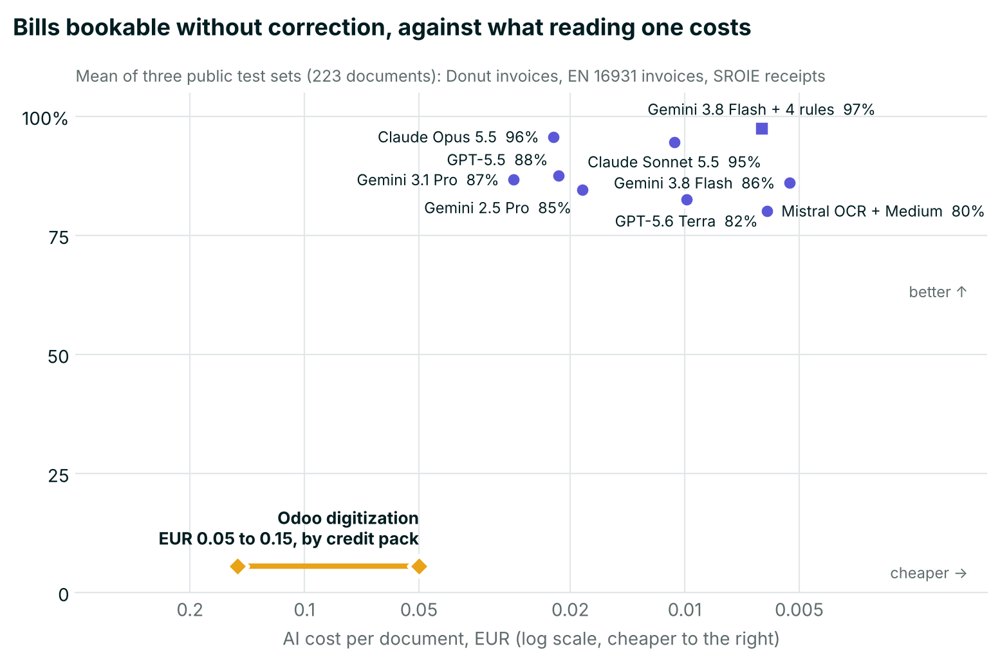
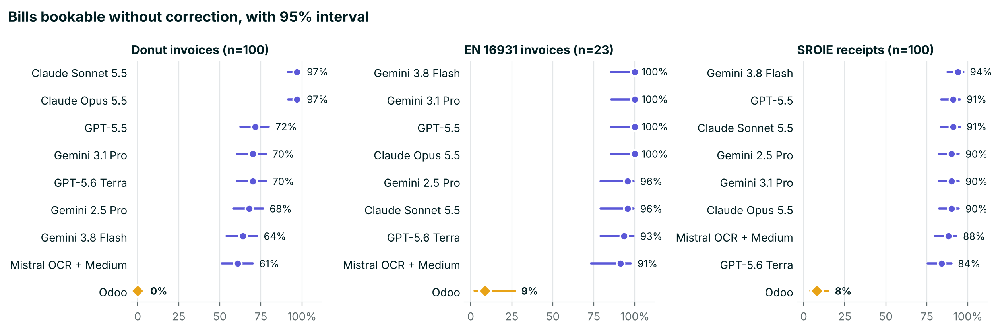
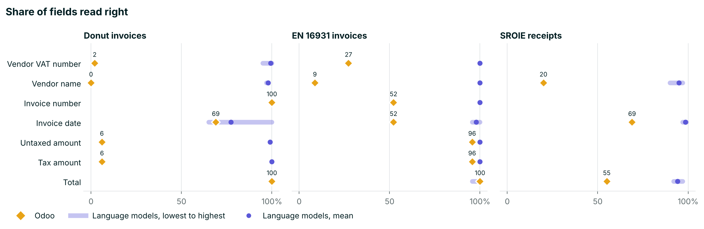
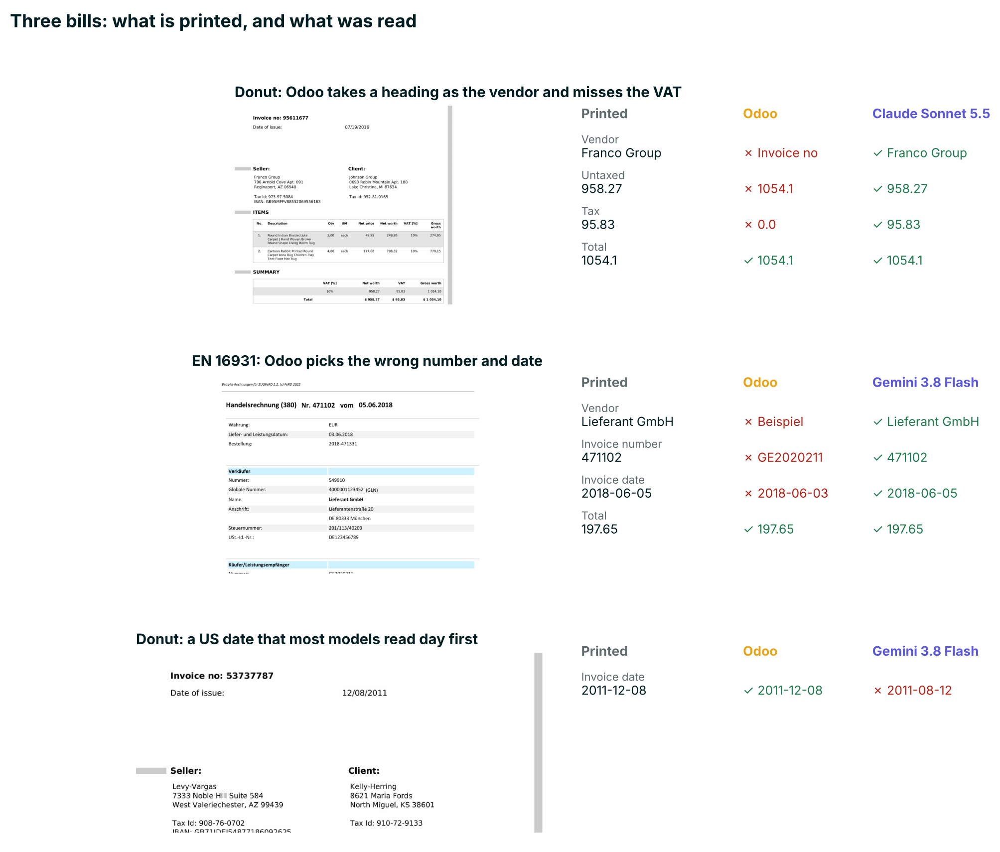
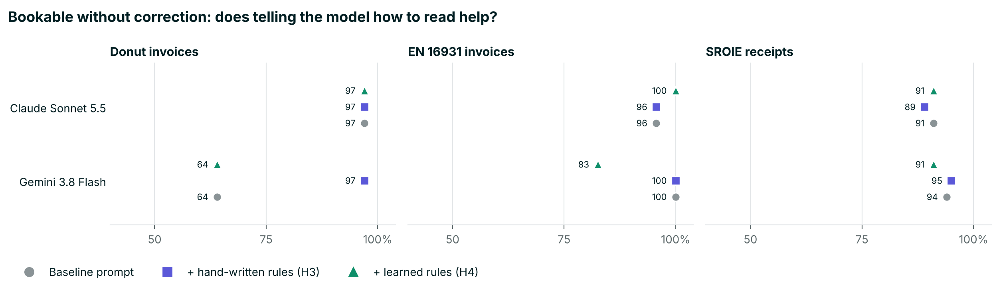
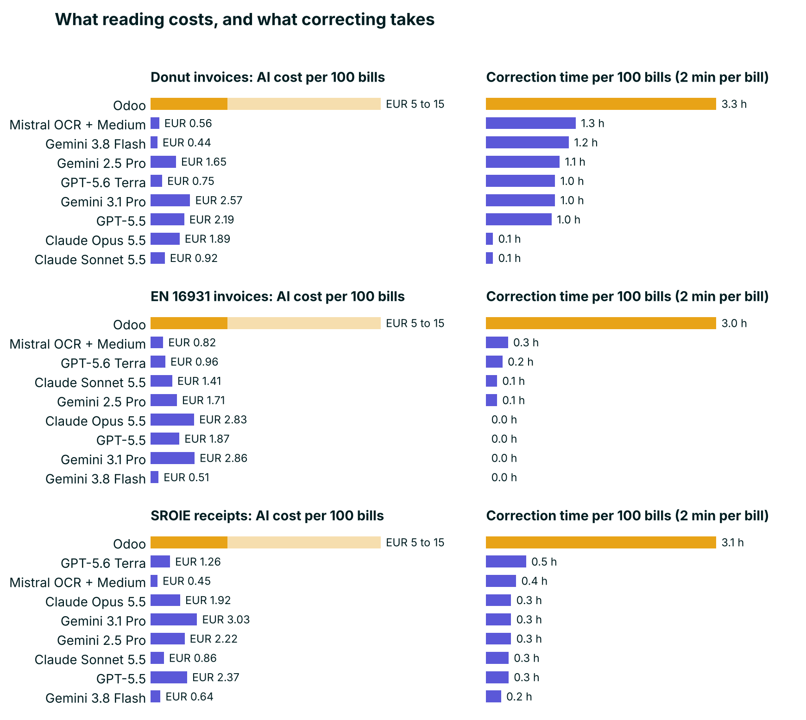

# How well does Odoo read a vendor bill? A reproducible comparison of Odoo's document digitization with eight multimodal language models

Pantalytics B.V., Rotterdam. Working paper, version 1, November 2026.

Code, data manifests and every raw answer are in this repository
([README](README.md)): github.com/pantalytics/odoo-iap-benchmark.

## Executive summary

Odoo can read supplier bills and receipts for you, built in and with
nothing to set up, at EUR 0.05 to 0.15 a document depending on the credit
pack. We measured how often the result can be booked without
correction, on 223 public test documents, and compared Odoo with eight AI
language models.

- **Odoo got 0 to 9% of documents fully right.** It often takes a heading
  as the supplier, picks the wrong number or date, misses the VAT on simple
  invoices, and on scanned receipts gets the total right only half the time.
- **Odoo's OCR is not the problem; the step after it is.** Given Odoo's own
  OCR text, Claude Sonnet 5.5 booked 94%, 100% and 88% of the documents,
  and Odoo's own candidate lists held the right supplier on 97 to 99% of
  the Donut bills and receipts (section 6.1, post-hoc).
- **The AI models got 61 to 100% fully right**, at EUR 0.004 to 0.03 a
  document: below Odoo's price even in its largest credit pack. They do
  need a one-off setup (a module, an API key, the instructions); Odoo's
  reader works out of the box.
- **Correcting costs more than reading.** Per 100 documents Odoo leaves
  about 3 hours of corrections, the best models 10 to 20 minutes. The AI
  cost differs by a few euros.
- **Best choices:** Claude Sonnet 5.5 (right without help, EUR 0.01 a
  document), or Gemini 3.8 Flash with four simple reading rules in its
  instructions (as accurate here, at half that price). Bigger, dearer models
  were not better.
- **VAT is read well:** VAT rates per line and VAT categories were right on
  practically every test invoice, though the public test set is small and
  has no reverse-charge invoice.
- **Self-learning is not free:** rules a model wrote from its own mistakes
  did not help, and one made things worse. Learning from corrections needs
  the document and its context, not just the error.

Caveat: we tested what Odoo's reading service returns, not the finished
bill inside an Odoo database, where Odoo also matches the supplier from
your contacts. A follow-up on real Dutch bills tests that.

## Abstract

Odoo's document digitization extracts vendor-bill fields with Google Cloud
Vision OCR followed by Odoo's own model; no accuracy figure has been
published. We compared it with eight multimodal language models on three
public sets: 100 Donut synthetic invoices, the 23 official EN 16931
(Factur-X) sample invoices with machine-readable VAT truth, and 100 scanned
SROIE receipts. The primary outcome was whether a document can be booked
without correction (vendor, number, date, currency, amounts and the base
per VAT rate all right). Odoo's Extract API reached 0%, 9% and 8%; the
language models 61 to 97%, 91 to 100% and 84 to 94%. Language-model errors
were mostly US dates read day first; one prompt rule about date
conventions raised Gemini 3.8 Flash from 64% to 97% on Donut. Rules learned
automatically from a training sample's errors did not help and lowered one
result, because the errors lacked the documents' context. AI cost per 100
documents was EUR 5 to 15 for Odoo, by credit pack, against EUR 0.44 to
3.03 for the models;
correction time, at two minutes per document, was about 3 hours against 0.1
to 1.3. Code, data, every raw answer and the pre-registered plan are
published.

## 1. Introduction

Odoo, an open-source ERP used by small and mid-sized companies, can read
vendor bills: a PDF is sent to Odoo's Extract API, and the fields of a
draft bill are filled in. The service costs one IAP credit per document, EUR 0.05 to 0.15 depending
on the pack, and needs no setup: it is on by default in Accounting.
Odoo publishes no accuracy figure for it, and we found no independent
measurement. Accuracy claims that circulate online come from vendors of
competing products and come without a method.

Meanwhile general-purpose multimodal language models (LLMs) read documents
directly from the page image. Berghaus et al. (2025) compared eight such
models on three public invoice sets and found that sending the page image
to the model beats extracting the text first and giving the model the text,
by 10 to 40 percentage points.

Odoo's service is built the second way: according to Odoo's IAP privacy
policy the document is converted to text by Google Cloud Vision, after
which Odoo's own model extracts the fields. That makes the comparison
interesting beyond Odoo: it is a production OCR-then-extract pipeline
against current image-in models.

For the people who use it, the question is whether a bill can be booked
as read, so we define the main outcome from an accountant's point of view
(section 4.5).

### Research questions

- **RQ1.** How often does Odoo's document digitization return a vendor bill
  that can be booked without correction?
- **RQ2.** How do current multimodal LLMs compare on the same bills, in
  accuracy, cost and time?
- **RQ3.** Does putting a dedicated OCR step in front of an LLM (Mistral OCR,
  then Mistral Medium) lose accuracy against giving the LLM the page?
- **RQ4.** How often are the VAT rate per line, the VAT summary and the VAT
  category read correctly?

## 2. Hypotheses

The study plan was written before any data was collected and kept under
version control. Every version of it is published in `plan-history/`, named
by commit time and hash, so the commit hashes below show when each
statement was made.

- **H1** (stated in commit `61632b1`, 2026-11-12 13:49 UTC, before any
  Odoo answer existed): image-in LLMs extract bill fields more accurately
  than Odoo's digitization, because Odoo puts an OCR step first.
- **H2** (commit `61632b1`): the OCR-first LLM pipeline is less accurate
  than image-in LLMs on these born-digital documents; OCR earns its place on
  bad scans only.
- RQ1 and RQ4 had no directional hypothesis; they are descriptive.
- **H3** (plan addendum, committed before any data for it): a short block of
  reading rules in the prompt (date convention by the vendor's country, who
  the vendor is, which number is the invoice number, no VAT shown means tax 0)
  raises the bookable rate by at least 10 points on Donut, without a drop of
  more than 5 points on the other sets.
- **H4** (same addendum): rules written automatically by a model from another
  model's errors on a separate training sample improve the held-out test
  results about as much as the hand-written rules of H3.

## 3. Related work

- **Berghaus et al. (2025)**, Fraunhofer IAIS: eight multimodal models,
  three public sets (Donut synthetic invoices, SROIE receipts, inv-cdip
  scanned invoices), exact-match field accuracy. Gemini 2.5 Pro scored
  96.5% on the Donut invoices. We reuse their Donut set to anchor our
  harness against theirs.
- **Text-recognition benchmarks** (OlmOCRBench, OmniDocBench) score how well
  text and layout are recognised, not whether a field holds the right
  value. Mistral reports 85.2 and 93.1 on them for OCR 4.
- **Key-information-extraction sets**: SROIE and CORD are till receipts;
  DocILE (Šimsa et al., 2023) holds 6,680 English business documents from
  US sources, with hidden test labels; inv-cdip (Gao et al., 2022) holds 350
  scanned US invoices from the 1980s and 1990s. None of them labels the VAT
  treatment of a bill.
- **Vendor leaderboards** (Nanonets IDP) are run by a vendor on its own
  task definitions.

We found no public benchmark that scores European VAT treatment. That gap
shaped the choice of data below.

## 4. Data and method

### 4.1 Test sets

Only public, standard sets were used, so that results can be compared and
repeated. Two hold vendor bills, one holds till receipts.

**Donut invoices.** `katanaml-org/invoices-donut-data-v1` on Hugging Face,
revision `d2cde298e79c94fb05bc320999deb4b7889b0464`, MIT licence. 501
synthetic English invoices with US addresses, rendered at 2481 × 3508
pixels, with structured ground truth (header, line items, summary). This is
the "clean invoices" set of Berghaus et al. Each JPEG was wrapped unchanged
in a one-page A4 PDF, so that every engine received the same file type.
For cost reasons we drew a fixed random sample of 100 bills
(`random.Random(42).sample`). The sample has 366 lines; 355 carry a VAT
rate (all 10%), 11 carry none. Currency is printed as "$" on 96 bills and
missing on 4.

**EN 16931 sample invoices.** The official Factur-X/ZUGFeRD sample invoices
published by FeRD (Germany) and FNFE-MPE (France) for the European
e-invoicing standard EN 16931, as collected in the ZUGFeRD corpus
(github.com/ZUGFeRD/corpus, commit
`84f8d8f68f6c3698aa3019d701a8b82db9ba0aac`, Apache-2.0). Each PDF carries
its invoice as CII XML, which gives exact ground truth, including the VAT
rate and EN 16931 VAT category per line and the VAT summary per rate.
Selection, applied in this order:

1. all PDFs in the corpus (151);
2. excluded: folders `fail/` (deliberately broken files) and
   `ZUGFeRDv1/` (format version without VAT detail);
3. excluded: PDFs without embedded CII XML, or without any VAT category;
4. excluded: duplicates, defined as the same invoice number and seller name
   (the same FeRD sample appears in several folders and versions).

That leaves 23 invoices with 53 lines: 18 from German sellers, 4 French,
1 British. VAT categories: 17 standard rate (S), 3 exempt (E), 2
intra-community supply (K), 1 export (G); 9 carry two VAT rates (7/19% or
5.5/20%); 2 are credit notes. No sample uses reverse charge (AE). The XML
was removed from each PDF before any engine saw it (only the pages were
copied to a new PDF), so that no engine could read the answer from the
attachment.

**SROIE receipts.** The ICDAR 2019 SROIE task 3 receipts: real scanned
till receipts from shops and restaurants in Malaysia, with four labelled
fields (company, date, address, total), in the copy published with labels
at github.com/zzzDavid/ICDAR-2019-SROIE (commit
`27be4271b251c256f695acbade9a801bffe85994`, 626 labelled receipts, MIT
licence on the repository). Berghaus et al. used the same copy. Each JPEG was
wrapped in a PDF as for Donut, and a fixed random sample of 100 was drawn
(seed 42). Dates are labelled day first in several formats; labels that are not a
plain day-first or ISO date would be left unscored (none in the sample). SROIE has no
VAT labels and no currency label; for receipts "bookable" means vendor
name, date and total right. SROIE was added after the first results, at the
research owner's request for real-world documents (section 8).

For all three sets, `truth.jsonl` records for every bill the source (dataset
and revision, or corpus commit and path) and the SHA-256 of the source
file.

### 4.2 Sets considered and not used

| Set | Reason |
|---|---|
| inv-cdip (scanned invoices of Berghaus et al.) | The UCSF Industry Documents Library refused automated download; also US documents without VAT |
| DocILE | English US documents, test labels not public |
| CORD | Phone photos of Indonesian receipts, but no store name and no date labelled |
| A synthetic EU VAT set of our own (150 bills, nine VAT scenarios) | Built, then discarded: a set we generate ourselves is not a standard and invites the suspicion of being tuned to a result |

### 4.3 Engines

| Engine | Model | Route |
|---|---|---|
| Odoo | Odoo Extract API, invoice route, API version 123 | `extract.api.odoo.com`, called directly with an IAP account token |
| Gemini 3.8 Flash | `google/gemini-3.8-flash` | OpenRouter, PDF passed natively |
| Gemini 3.1 Pro | `google/gemini-3.1-pro-preview` | same |
| Gemini 2.5 Pro | `google/gemini-2.5-pro` | same; the best model of Berghaus et al., as anchor |
| Claude Sonnet 5.5 | `anthropic/claude-sonnet-5.5` | same |
| GPT-5.5 | `openai/gpt-5.5` | same |
| GPT-5.6 Terra | `openai/gpt-5.6-terra` | same; added after the first results |
| Claude Opus 5.5 | `anthropic/claude-opus-5.5` | same; added after the first results |
| Mistral OCR → Mistral Medium 3.5 | `mistralai/mistral-medium-3-5` | OpenRouter `file-parser` plugin with engine `mistral-ocr`: the page goes through Mistral OCR, the model gets its text |

All LLMs received the same one-paragraph prompt and the same JSON schema
(`src/bench_invoices.py`, `PROMPT` and `SCHEMA`), at temperature 0, with
structured output enforced. The prompt says the document is a bill
received from a supplier, asks for ISO dates and plain numbers, and asks
for null where a value is absent. The schema asks for the header fields,
the lines (description, quantity, unit price, VAT rate, net amount), the
VAT summary (rate, base, tax per rate) and the EN 16931 VAT category.

Odoo received what an Odoo database sends: `perspective: client` (the
bill was received) and the buyer's company name, VAT number and country as
`user_infos`, taken per bill from the ground truth, since a database always
knows its own company. Odoo's API returns no VAT category: in Odoo the
category follows from the vendor's fiscal position in the database, so that
field is not held against Odoo.

Model ids were checked against OpenRouter's model list on 2026-11-12, the
day all runs took place. Costs per call are OpenRouter's reported cost.
Odoo's cost is the list price of one IAP credit (iap.odoo.com, 2026-11-12):
EUR 0.15 in the 100-credit pack, 0.12 at 1,000, 0.10 at 10,000 and 0.05 at
100,000. Tables and figures show the range. Seconds are wall-clock
time per bill, including Odoo's polling at 5-second intervals.

### 4.4 Reading rules and the learning loop (H3, H4)

The baseline prompt says only what the document is and which format to
answer in. For H3 a block of four reading rules, fixed in the plan before
any data for it (`RULES` in `src/bench_invoices.py`), is added: read dates in
the convention of the vendor's country; the vendor is never a heading or
the buyer; the invoice number is the bill's own number, not an order,
customer or delivery number; no VAT shown means tax 0.

For H4 the rules are written by a model instead of by us. Gemini 3.8 Flash
read a training sample with the baseline prompt: 50 Donut bills and 50
SROIE receipts drawn with seed 7 from the bills that are not in the test
samples. Its wrong header fields (field, right value, its value) went to
Claude Opus 5.5 with the request to write at most 10 general rules that
quote no value from the errors (`src/learn_rules.py`). Those rules
(`results/rules_learned.txt`, with the full request and answer in
`rules_learned.trace.json`) were then added to the prompt unchanged.

H3 and H4 were each run once with two models, the cheapest (Gemini 3.8
Flash) and the most accurate of run 1 (Claude Sonnet 5.5), on the same three
test samples as the baseline. Odoo's API takes no instructions and is not
part of H3 or H4.

This is the simplest form of a learning loop: errors in, rules out, no
model training. In production the errors would be the corrections a
bookkeeper makes; here the ground truth plays that role.

### 4.5 Outcomes

**Primary outcome: bookable without correction.** A bill counts as
bookable when every field an accountant needs to post it is right:

- the vendor: its VAT number when the bill has one, else its name;
- invoice number, invoice date, currency;
- untaxed amount, tax amount, total;
- the VAT summary: the base amount per VAT rate. Truth is the printed VAT
  table (EN 16931) or, where a bill has none, the sum of line amounts per
  rate (Donut). A prediction's summary is its VAT table if it gave one,
  else the sum of its line amounts per rate. One line per VAT rate is as
  bookable as many: Odoo itself offers that option.

Due date, IBAN and line descriptions serve payment and reading, not
booking, and are reported separately. A field whose truth is absent is not
scored.

**Secondary outcomes:** accuracy per field, all header fields together,
line fields (description, quantity, unit price, VAT rate) matched by
position, VAT rate per line, VAT category, cost and time per bill.

**Matching rules.** Amounts and quantities match within 0.005, compared by
absolute value. Dates are compared as ISO dates. VAT numbers are compared
without separators and without a leading country code. Codes (invoice
number, IBAN, currency) are compared upper-case without separators; a
currency sign counts as its ISO code. Names count when one contains the
other (after lower-casing and removing punctuation) or when their
similarity ratio is at least 0.9, and the prediction is at least 4
characters. Truth IBANs that fail the ISO 13616 checksum are not scored
(section 6.7).

**Statistics.** Proportions carry a 95% Wilson score interval. For field
accuracy the interval treats fields as independent, which they are not
within a bill; it is a lower bound on the uncertainty. Each language model
was run twice on the invoice sets and once on the receipts; we report the
mean and the range. Odoo was run twice on the 123 invoices, once without and
once with the buyer hints, and returned byte-identical answers both times,
so the same answers are scored in both runs. It was run once on the
receipts.

## 5. Results

Square brackets give the 95% Wilson interval of the bookable rate. "Line
VAT rate" is the share of lines whose VAT rate is right, matched by
position; "VAT summary" the share of bills whose base amount per VAT rate is
right. The invoice sets were read twice by every language model, the
receipts once; the tables give the mean, the run range is in
`results/<set>/aggregate.md`. Figure 1 shows the bookable rate, figure 2
where Odoo and the models differ field by field, figure 4 three examples.

### 5.1 Donut invoices (100 bills, 2 runs)

| Engine | Bookable % [95% CI] | Range over runs | Header fields % | Line VAT rate % | VAT summary % | EUR per bill | Seconds per bill |
|---|---|---|---|---|---|---|---|
| Odoo digitization | 0 [0 to 4] | 0 to 0 | 51.5 | 4 | 6 | 0.150 | 8 |
| Claude Opus 5.5 | 97 [92 to 99] | 97 to 97 | 99.5 | 100 | 99 | 0.019 | 6 |
| Claude Sonnet 5.5 | 97 [92 to 99] | 97 to 97 | 99.5 | 100 | 99 | 0.009 | 4 |
| GPT-5.5 | 72 [63 to 80] | 70 to 73 | 96.1 | 100 | 99 | 0.022 | 9 |
| GPT-5.6 Terra | 70 [60 to 78] | 66 to 74 | 96.0 | 100 | 99 | 0.008 | 5 |
| Gemini 3.1 Pro | 70 [60 to 78] | 69 to 71 | 96.2 | 100 | 99 | 0.026 | 21 |
| Gemini 2.5 Pro | 68 [58 to 76] | 66 to 70 | 95.9 | 100 | 99 | 0.017 | 16 |
| Gemini 3.8 Flash | 64 [54 to 73] | 64 to 64 | 95.4 | 100 | 99 | 0.004 | 9 |
| Mistral OCR → Mistral Medium 3.5 | 61 [51 to 70] | 61 to 61 | 95.0 | 100 | 99 | 0.006 | 5 |

Per field, % right (mean over runs):

| Field | Odoo | Opus | Sonnet | Terra | GPT-5.5 | Gem 3.1 Pro | Gem 2.5 Pro | Gem Flash | Mistral |
|---|---|---|---|---|---|---|---|---|---|
| Vendor name | 0 | 98 | 98 | 97 | 98 | 98 | 98 | 98 | 98 |
| Vendor VAT number | 2 | 100 | 100 | 100 | 100 | 100 | 100 | 100 | 95 |
| Invoice number | 100 | 100 | 100 | 100 | 100 | 100 | 100 | 100 | 100 |
| Invoice date | 69 | 100 | 100 | 72 | 74 | 71 | 71 | 65 | 66 |
| Currency | 100 | 100 | 100 | 100 | 100 | 100 | 98 | 100 | 100 |
| Untaxed | 6 | 99 | 99 | 99 | 99 | 99 | 99 | 99 | 99 |
| Tax | 6 | 100 | 100 | 100 | 100 | 100 | 100 | 100 | 100 |
| Total | 100 | 100 | 100 | 100 | 100 | 100 | 100 | 100 | 100 |
| IBAN | 92 | 99 | 99 | 97 | 94 | 99 | 97 | 98 | 98 |

### 5.2 EN 16931 sample invoices (23 bills, 2 runs)

| Engine | Bookable % [95% CI] | Range over runs | Header fields % | Line VAT rate % | VAT summary % | EUR per bill | Seconds per bill |
|---|---|---|---|---|---|---|---|
| Odoo digitization | 9 [2 to 27] | 9 to 9 | 66.8 | 38 | 96 | 0.150 | 7 |
| Claude Opus 5.5 | 100 [86 to 100] | 100 to 100 | 100.0 | 100 | 100 | 0.028 | 5 |
| GPT-5.5 | 100 [86 to 100] | 100 to 100 | 100.0 | 98 | 100 | 0.019 | 7 |
| Gemini 3.1 Pro | 100 [86 to 100] | 100 to 100 | 100.0 | 99 | 100 | 0.029 | 23 |
| Gemini 3.8 Flash | 100 [86 to 100] | 100 to 100 | 100.0 | 100 | 100 | 0.005 | 11 |
| Claude Sonnet 5.5 | 96 [79 to 99] | 96 to 96 | 99.1 | 98 | 100 | 0.014 | 3 |
| Gemini 2.5 Pro | 96 [79 to 99] | 96 to 96 | 99.1 | 100 | 100 | 0.017 | 17 |
| GPT-5.6 Terra | 93 [79 to 99] | 91 to 96 | 98.4 | 100 | 100 | 0.010 | 4 |
| Mistral OCR → Mistral Medium 3.5 | 91 [73 to 98] | 91 to 91 | 97.8 | 98 | 100 | 0.008 | 4 |

Per field, % right (mean over runs):

| Field | Odoo | Opus | Sonnet | Terra | GPT-5.5 | Gem 3.1 Pro | Gem 2.5 Pro | Gem Flash | Mistral |
|---|---|---|---|---|---|---|---|---|---|
| Vendor name | 9 | 100 | 100 | 100 | 100 | 100 | 100 | 100 | 100 |
| Vendor VAT number | 27 | 100 | 100 | 100 | 100 | 100 | 100 | 100 | 100 |
| Invoice number | 52 | 100 | 100 | 100 | 100 | 100 | 100 | 100 | 100 |
| Invoice date | 52 | 100 | 96 | 96 | 100 | 100 | 96 | 100 | 96 |
| Currency | 96 | 100 | 100 | 100 | 100 | 100 | 100 | 100 | 100 |
| Untaxed | 96 | 100 | 100 | 100 | 100 | 100 | 100 | 100 | 100 |
| Tax | 96 | 100 | 100 | 100 | 100 | 100 | 100 | 100 | 100 |
| Total | 100 | 100 | 100 | 98 | 100 | 100 | 100 | 100 | 96 |
| Due date | 83 | 100 | 92 | 92 | 100 | 100 | 92 | 100 | 92 |
| IBAN | 57 | 100 | 100 | 100 | 100 | 100 | 100 | 100 | 71 |
| VAT category | - | 100 | 100 | 96 | 100 | 100 | 100 | 100 | 100 |

### 5.3 SROIE receipts (100 receipts, 1 run)

| Engine | Bookable % [95% CI] | Header fields % | Line VAT rate % | VAT summary % | EUR per bill | Seconds per bill |
|---|---|---|---|---|---|---|
| Odoo digitization | 8 [4 to 15] | 48.0 | - | - | 0.150 | 8 |
| Gemini 3.8 Flash | 94 [88 to 97] | 97.3 | - | - | 0.006 | 15 |
| Claude Sonnet 5.5 | 91 [84 to 95] | 96.3 | - | - | 0.009 | 3 |
| GPT-5.5 | 91 [84 to 95] | 96.3 | - | - | 0.024 | 11 |
| Claude Opus 5.5 | 90 [83 to 94] | 96.0 | - | - | 0.019 | 7 |
| Gemini 3.1 Pro | 90 [83 to 94] | 96.0 | - | - | 0.030 | 26 |
| Gemini 2.5 Pro | 90 [83 to 94] | 96.0 | - | - | 0.022 | 21 |
| Mistral OCR → Mistral Medium 3.5 | 88 [80 to 93] | 95.0 | - | - | 0.004 | 4 |
| GPT-5.6 Terra | 84 [76 to 90] | 94.0 | - | - | 0.013 | 7 |

Per field, % right (mean over runs):

| Field | Odoo | Opus | Sonnet | Terra | GPT-5.5 | Gem 3.1 Pro | Gem 2.5 Pro | Gem Flash | Mistral |
|---|---|---|---|---|---|---|---|---|---|
| Vendor name | 20 | 97 | 97 | 90 | 94 | 96 | 96 | 96 | 94 |
| Invoice date | 69 | 99 | 98 | 99 | 98 | 99 | 99 | 99 | 97 |
| Total | 55 | 92 | 94 | 93 | 97 | 93 | 93 | 97 | 94 |

### 5.4 Under the original scoring rules

The same answers scored with the rules as first written (`--strict`, section 8), mean over runs.

**Donut**

| Engine | Bookable % | Header fields % |
|---|---|---|
| Odoo digitization | 0 | 50.1 |
| Claude Opus 5.5 | 97 | 96.9 |
| Claude Sonnet 5.5 | 97 | 96.9 |
| GPT-5.6 Terra | 70 | 93.4 |
| GPT-5.5 | 72 | 93.5 |
| Gemini 3.1 Pro | 70 | 93.6 |
| Gemini 2.5 Pro | 68 | 93.3 |
| Gemini 3.8 Flash | 64 | 92.9 |
| Mistral OCR → Mistral Medium 3.5 | 61 | 92.5 |

**EN 16931**

| Engine | Bookable % | Header fields % |
|---|---|---|
| Odoo digitization | 9 | 62.9 |
| Claude Opus 5.5 | 96 | 96.5 |
| Claude Sonnet 5.5 | 91 | 95.6 |
| GPT-5.6 Terra | 89 | 95.0 |
| GPT-5.5 | 96 | 96.5 |
| Gemini 3.1 Pro | 96 | 96.5 |
| Gemini 2.5 Pro | 91 | 95.6 |
| Gemini 3.8 Flash | 96 | 96.3 |
| Mistral OCR → Mistral Medium 3.5 | 85 | 94.1 |

**SROIE**

| Engine | Bookable % | Header fields % |
|---|---|---|
| Odoo digitization | 10 | 48.7 |
| Claude Opus 5.5 | 90 | 96.0 |
| Claude Sonnet 5.5 | 90 | 95.7 |
| GPT-5.6 Terra | 83 | 93.7 |
| GPT-5.5 | 90 | 96.0 |
| Gemini 3.1 Pro | 84 | 94.0 |
| Gemini 2.5 Pro | 90 | 96.0 |
| Gemini 3.8 Flash | 93 | 97.0 |
| Mistral OCR → Mistral Medium 3.5 | 85 | 94.0 |

### 5.5 Reading rules and the learning loop (H3, H4)

Bookable without correction, %, on the same test samples. Baseline: mean of
the runs above; H3 and H4: one run each (`results/prompting.md`,
`results/<set>/h3`, `h4`).

| Set | Model | Baseline | + hand-written rules (H3) | + learned rules (H4) |
|---|---|---|---|---|
| Donut | Gemini 3.8 Flash | 64 | **97** | 64 |
| Donut | Claude Sonnet 5.5 | 97 | 97 | 97 |
| EN 16931 | Gemini 3.8 Flash | 100 | 100 | **83** |
| EN 16931 | Claude Sonnet 5.5 | 96 | 96 | 100 |
| SROIE | Gemini 3.8 Flash | 94 | 95 | 91 |
| SROIE | Claude Sonnet 5.5 | 91 | 89 | 91 |

The hand-written rules lifted Gemini 3.8 Flash on Donut from 64% to 97%,
all of it on the date: 65% of its dates were right without the rule, 100%
with it. Claude Sonnet 5.5, already at 97%, did not move. On the other sets
nothing moved by more than 2 points.

The learned rules did not help. Gemini 3.8 Flash read the 100 training
documents with 22 wrong header fields: 18 dates with day and month swapped,
one vendor name, and three empty fields from one call that failed (the
failure counted as an error, a flaw in our loop). Claude Opus 5.5 turned
them into ten rules (`results/rules_learned.txt`). The error list showed the
swaps but not the documents, so the teacher could not see that the bills
were American; its rule says "do not assume month first", the opposite of
what these bills need, and the Donut dates stayed wrong. And one rule hurt: "for the
total, take the final amount payable (total, grand total, nett or amount
due)", right for receipts, made Gemini 3.8 Flash return the amount still
due instead of the invoice total on 4 EN 16931 bills with a prepayment,
which dropped it from 100% to 83%.

### 5.6 Hypotheses

- **H1 supported.** Every language model produced more bookable bills than
  Odoo on all three sets, far outside the intervals: Odoo 0%, 9% and 8%;
  the models 61 to 97%, 91 to 100% and 84 to 94%.
- **H2 partly supported.** The OCR-first pipeline was the least accurate
  language model on both invoice sets (61% and 91%), but not on the
  receipts (88%, above GPT-5.6 Terra). Its intervals overlap those of most
  image-in models; on Donut only the two Claude models are clearly ahead.
- **H3 supported for one model.** The rules lifted Gemini 3.8 Flash by 33
  points on Donut and cost no model more than 2 points elsewhere. They did
  nothing for Claude Sonnet 5.5, which read the dates right without them.
  The rules were written after seeing the baseline errors on these test
  sets, so this is the best case for hand-written rules.
- **H4 not supported.** Rules learned from a disjoint training sample did
  not improve the test results and lowered one model on one set by 17
  points.

## 6. Discussion

### 6.1 Where Odoo goes wrong

The vendor is Odoo's weakest field. Its raw read named the vendor on 0 of
100 Donut bills and 2 of 23 EN 16931 bills, often returning a heading
instead ("Invoice no", "Beispiel"), and found the vendor's VAT number on 2%
and 27% of them.

On the EN 16931 bills half the invoice numbers and dates were wrong. Odoo
picked another number on the page, a customer or order number, and another
date, usually the delivery date.

On 93 of 99 Donut bills Odoo returned the total as the untaxed amount and 0
as the tax: it did not read the VAT column. On the EN 16931 bills it got
both right on 22 of 23.

Odoo returns one line per VAT rate rather than the article lines (1.4 lines
per bill against 2.3 printed). Matched line by line that scores low, but as
a VAT summary it is right on 22 of 23 EN 16931 bills. Odoo itself offers
"one line per tax" as a booking option, so the merged lines are not the
problem for an accountant; the lost article detail is.

Totals and currency Odoo reads reliably on the invoices (96 to 100%). On
the scanned receipts it does not: it got the total on 55 of 100 and the shop
name on 20, returning fragments such as "SR", "CASH" or "GST Summary" as
the vendor.

**Is it the OCR or the extraction? (post-hoc, not pre-registered)** Odoo's
answer contains its OCR words with their positions and, per field, the
candidates it considered and the one it selected. That allows two checks
without new Odoo calls. First, whether the right value was among Odoo's own
candidates (`src/odoo_candidates.py`, `results/odoo_candidates.md`).
Second, whether a language model reading the same OCR text does better: we
laid Odoo's words out as text in their page positions and gave that text,
not the PDF, to Claude Sonnet 5.5 with the baseline prompt (engine
`odoo-ocr-sonnet`, `results/<set>/odoo-ocr/`, one run, USD 1.80).

| Bookable % | Donut | EN 16931 | SROIE |
|---|---|---|---|
| Odoo: its OCR, its extraction | 0 | 9 | 8 |
| Odoo's OCR text, read by Claude Sonnet 5.5 | 94 | 100 | 88 |
| Claude Sonnet 5.5 reading the page itself (mean of runs) | 97 | 96 | 91 |

| Right value among Odoo's candidates, % (selected %) | Donut | EN 16931 | SROIE |
|---|---|---|---|
| Vendor name | 99 (0) | 65 (9) | 97 (20) |
| Invoice number | 100 (100) | 100 (52) | - |
| Invoice date | 69 (69) | 100 (52) | 72 (70) |
| Untaxed amount | 100 (6) | 100 (96) | - |
| Tax | 100 (6) | 100 (96) | - |
| Total | 100 (100) | 100 (100) | 94 (55) |

Odoo's OCR captured nearly everything a booking needs; its extraction
step chose wrongly. The supplier is the clearest case: present in the
candidate list on almost every Donut bill and receipt, selected almost
never. Candidate lists hold up to some 30 entries and names match by
containment, so the candidate column is an upper bound. Dates are the
exception: the US dates Odoo misread were already normalised day first in
every candidate, so that error sits before the selection. Reading the
page image instead of Odoo's text gained Sonnet 3 points on Donut and
SROIE, consistent with H2, and lost 4 on EN 16931 (one bill).

In a database Odoo resolves the supplier from its VAT number, IBAN or
e-mail against existing contacts, which may be why its own selection of
the name gets little weight. This analysis does not measure that path.

### 6.2 Where the language models go wrong

Almost every language-model error on Donut is a date. Donut prints US
dates, month first (09/10/2015). Claude Sonnet 5.5 and Claude Opus 5.5 read
all of them correctly; the other six read 26 to 35 of 100 day first. That
alone makes the gap between Claude (97% bookable) and the rest (61 to 72%).
The same happened on the one French EN 16931 sample that prints a US date.
One sentence in the prompt about date conventions closes most of that gap
(section 5.5).

Apart from dates the models differ little on the clean invoices: vendor,
VAT number, invoice number, amounts and VAT summary are at 95 to 100% for
all of them. On the scanned receipts they spread more (84 to 94%), with
GPT-5.6 Terra last on the vendor name; the cheapest model, Gemini 3.8 Flash,
was the most accurate there.

The bigger model did not help. Claude Opus 5.5 scored the same as Claude
Sonnet 5.5 on Donut, 4 points higher on EN 16931 and 1 point lower on the
receipts, at twice the price. GPT-5.6 Terra, the newer OpenAI model, scored
the same as or below GPT-5.5 on all three sets.

### 6.3 VAT

Every language model read the VAT rate of practically every line (98 to
100%), the VAT summary of every bill, and the EN 16931 VAT category of
practically every bill, including the mixed-rate, exempt, intra-community
and export cases. The set is small and has no reverse-charge bill, so this
shows that the models can read VAT, not how often they will on a company's
real mix.

### 6.4 Cost and time

AI cost and human time are reported apart (figure 3). AI cost is what was
billed: OpenRouter's reported cost per call for the language models, and
the list price of Odoo's credits for Odoo, from EUR 0.15 a credit in the
smallest pack to EUR 0.05 in the largest. Human time is the number of documents that are not bookable as read,
times an assumed two minutes to correct one (`results/<set>/aggregate.md`).

| Per 100 documents | AI cost | To correct: Donut | EN 16931 | SROIE |
|---|---|---|---|---|
| Odoo | EUR 5.00 to 15.00 | 100, 3.3 h | 91, 3.0 h | 92, 3.1 h |
| Claude Sonnet 5.5 | EUR 0.86 to 1.41 | 3, 0.1 h | 4, 0.1 h | 9, 0.3 h |
| Claude Opus 5.5 | EUR 1.89 to 2.83 | 3, 0.1 h | 0 | 10, 0.3 h |
| Gemini 3.8 Flash | EUR 0.44 to 0.64 | 36, 1.2 h | 0 | 6, 0.2 h |
| Gemini 3.8 Flash with the H3 rules | about the same | 3, 0.1 h | 0 | 5, 0.2 h |
| GPT-5.6 Terra | EUR 0.75 to 1.26 | 30, 1.0 h | 7, 0.2 h | 16, 0.5 h |
| GPT-5.5 | EUR 1.87 to 2.37 | 29, 1.0 h | 0 | 9, 0.3 h |
| Gemini 3.1 Pro | EUR 2.57 to 3.03 | 30, 1.0 h | 0 | 10, 0.3 h |
| Gemini 2.5 Pro | EUR 1.65 to 2.22 | 32, 1.1 h | 4, 0.1 h | 10, 0.3 h |
| Mistral OCR → Medium | EUR 0.45 to 0.82 | 39, 1.3 h | 9, 0.3 h | 12, 0.4 h |

The AI cost differs by a few euros per 100 documents; the correcting differs
by hours. Even at Odoo's bulk price of EUR 5 per 100, every model was
cheaper per document. Unless an hour of correcting is worth less than a few euros, the
engine that is right most often is also the cheapest in total. Between
engines that are equally right, the AI cost decides.

Setup is the one cost on Odoo's side of the ledger. Odoo's reader is on by
default: no module, no API key, no instructions to maintain. A language
model needs all three once, which is implementation time we did not
measure. At three hours of correcting saved per hundred documents, that
setup pays back after a few hundred documents.

Time per document: Claude Sonnet 5.5, GPT-5.6 Terra and the Mistral pipeline
answered in 3 to 7 seconds, Gemini 3.1 Pro in 20 to 26. Odoo took 7 to 8,
mostly waiting on its queue.

### 6.5 What this means for an Odoo user

Read raw, Odoo's digitization gives a draft that needs correcting on nearly
every document in these sets: the vendor, the number and the date, the tax
on US-style bills, and the total on scanned receipts. Inside a database the
vendor lookup will recover part of the vendor errors (section 7), but not
the numbers, dates and amounts.

A current language model gets most of these documents right as read, for
less than Odoo's credit even in bulk, and saves around three hours of correcting
per hundred documents. On these sets two choices stand out: Claude Sonnet
5.5 (right without help, EUR 0.01 a document) and Gemini 3.8 Flash with the
four reading rules of H3 (as accurate on these sets, at half the price).
The larger models (Claude Opus 5.5, Gemini 3.1 Pro) cost more and were not
more accurate. A follow-up on real Dutch vendor bills will tell for those.

### 6.6 Learning from corrections

A loop that turns errors into rules is attractive: every correction a
bookkeeper makes could teach the reader. Our simplest version failed in an
instructive way. Errors without the document lose the cause: the teacher
saw day and month swapped but not that the vendor was American, and wrote
the opposite rule. And rules travel: a rule that is right for receipts
("the total is the amount due") is wrong for invoices with a prepayment. A
working loop would pass the document, or at least its country and type,
with each error, and keep rules per document type or per vendor. That is,
in effect, what Odoo does inside a database when it remembers a vendor's
accounts and taxes from earlier bills.

### 6.7 The ground truth has errors too

In 25 of the 100 Donut bills of our sample, the IBAN in the ground truth
fails its own checksum ("GB82D)FU82ZI3146210425"): the labels were partly
produced by OCR. Every model read these IBANs as printed, and was marked
wrong. Berghaus et al. name IBAN as the hardest field on this set; part of
that difficulty is in the labels. We exclude such truths from scoring.

## 7. Limitations

- Raw read, not the booked bill. We scored what Odoo's Extract API
  returns. Inside a database Odoo also searches the vendor in the partner
  list (by VAT number, name, bank account) and applies the vendor's fiscal
  position and default taxes. The bill an accountant finally sees can be
  better than the raw read, or worse where defaults override a correct
  read. A follow-up study books real bills in a real database.
- Mostly clean documents. Both invoice sets are generated PDFs. The SROIE
  receipts are real scans, but flatbed scans of Malaysian till receipts, not
  phone photos of European bills. H2 is tested on clean invoices and on these
  scans only.
- Small VAT set. The EN 16931 set has 23 bills, mostly German, and no
  reverse-charge sample. Its VAT results show capability, not a rate that
  carries to a company's real mix of bills.
- US conventions in Donut. Donut prints US dates (month first), which
  European readers, human or model, misread when the day is 12 or less.
  This affects the date field and so the bookable rate.
- Model drift. Hosted models change behind the same name, and
  temperature 0 does not make their output deterministic. The run-to-run
  range shows the second; nothing here guards against the first.
- Possible caching at Odoo. Odoo's two runs were identical to the byte.
  The service may cache results per file, in which case our two runs are
  not independent evidence of determinism.
- H3 is a best case. The hand-written rules were written after seeing the
  baseline errors on the same test sets, so their effect is an upper bound
  for rules written in advance; H4 is the held-out version.
- H3 and H4 ran once, with two models. A difference of a few points between
  arms is within run-to-run noise (up to 8 points for one model on Donut).
- One failed call counted as errors in the H4 training sample (section 5.5).
- Scoring rules revised after a first look. See section 8. Results under
  the original rules are published alongside (`*_strict.*`).

## 8. Deviations from the plan

| Planned (plan commit) | Done | Why |
|---|---|---|
| Fraunhofer's scanned set inv-cdip (`a889638`) | Not used | Automated download refused by the source library |
| A synthetic EU VAT set of our own (`ffa4567`) | Built, then removed (`32a3c5f`) | Not a standard set; decided by the research owner before any result on it |
| Primary outcome: header-field accuracy | Primary outcome: bookable without correction | Header-field accuracy does not answer the practical question; changed at the research owner's request after the first results, before the repeated runs |
| One run per engine | Planned three runs per language model; done two on the invoice sets, one on SROIE | Two runs measure run-to-run variation; the third did not fit the OpenRouter credit limit of the study |
| Two test sets | SROIE receipts added | Requested by the research owner after the first results, for real scanned documents |
| Six language models | Eight: GPT-5.6 Terra and Claude Opus 5.5 added | Asked by the research owner after the first results. GPT-5.5 had been chosen as OpenAI's newest model by mistake; GPT-5.6 Terra is newer. GPT-5.5 stays in as the earlier generation |
| (not planned) | H3 and H4, reading rules and a learning loop | Added at the research owner's request after the first results; pre-registered in a plan addendum before any data for them |
| (not planned) | An exploratory run of all engines with an earlier schema (no VAT summary, no line amount) is not reported | It preceded the final schema; its numbers were within a few points of run 1 and led to the scoring revisions below |
| (not planned) | Post-hoc: Odoo's OCR text read by Claude Sonnet 5.5, and the truth checked against Odoo's own candidates (section 6.1) | Asked by the research owner to explain Odoo's result; run after all planned results were published, on Odoo's cached answers only |
| Scoring rules as first written | Four rules revised after inspecting the first LLM answers: (1) names match by containment, not prefix ("Au bon moulin" against "Au bon moulin SARL"); (2) amounts by absolute value (credit notes print negative amounts where the XML holds positive ones); (3) truth IBANs failing their checksum not scored; (4) the VAT summary added to the schema, since line amounts computed as quantity × price miss discounts | Each revision corrects a scoring error that marked a right answer wrong for every engine alike. The original rules remain available (`--strict`) and their results are published |

## 9. Reproducibility

All code is in `src/`, all raw answers of all engines in `results/`, with
the truth files and their source hashes. Truth, answers, calls (model,
provider, time, cost, tokens) and scores are also given as CSV; `DATA.md`
describes every file and column. Scores can be recomputed from the
raw answers at no cost; the full study can be repeated with an OpenRouter
key and an Odoo IAP account (README). Runs took place on 2026-11-12 with
Python 3.13.18 and pypdf 7.0.1. Total cost of the study: USD 70.11 on
OpenRouter (every language-model call, failed ones included) and about 350
Odoo IAP credits (EUR 50 bought).

## 10. Conflict of interest

Pantalytics sells AI Pro, a module that runs language models inside Odoo,
and so has an interest in language models doing well against Odoo's own
service. To keep that interest from steering the result we used only
public data, wrote the hypotheses down before collecting it, publish every
raw answer and the scoring under the original rules, and give the code to
anyone who wants to check it.

## References

- Berghaus, D., Berger, A., Hillebrand, L., Cvejoski, K., Sifa, R. (2025).
  Multi-Modal Vision vs. Text-Based Parsing: Benchmarking LLM Strategies for
  Invoice Processing. arXiv:2509.04469.
- Kim, G. et al. (2022). OCR-free Document Understanding Transformer.
  ECCV 2022.
- Šimsa, Š. et al. (2023). DocILE Benchmark for Document Information
  Localization and Extraction. ICDAR 2023. arXiv:2302.05658.
- Gao, M. et al. (2022). Field Extraction from Forms with Unlabeled Data
  (inv-cdip). github.com/salesforce/inv-cdip.
- CEN (2017). EN 16931-1: Electronic invoicing, semantic data model.
- Odoo S.A. Extract API, Odoo 19.0 documentation; In-App Purchase privacy
  policy, iap.odoo.com/privacy (consulted 2026-11-12).
- Mistral AI (2026). Mistral OCR 4 announcement, as reported by VentureBeat,
  2026-06-24.
